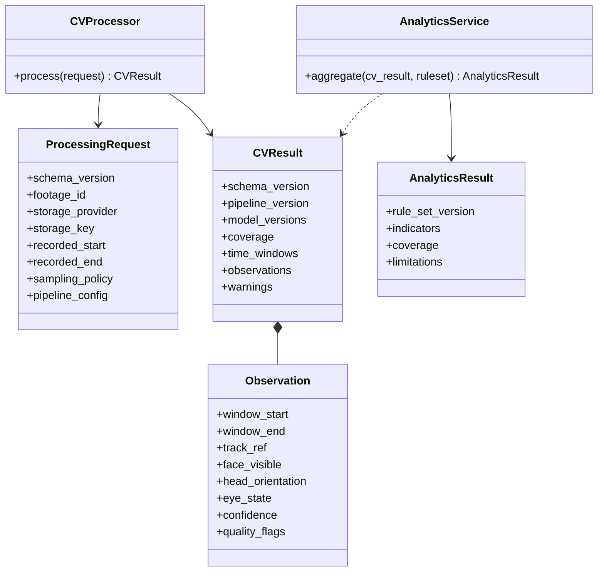

# AI/CV architecture

The CV layer is responsible for media decoding, frame sampling, detection/tracking, face/landmark analysis, temporal observable-feature extraction, and emitting a versioned structured artifact. It does not own user authorization, application database writes, engagement metric definitions, reports, or recommendations. The orchestration worker supplies an authorized storage stream/reference and configuration; it validates the returned contract before persistence/analytics.

Candidate tools include OpenCV, YOLO person detection, DeepSORT or an evaluated alternative for tracking, and MediaPipe/facial landmarks. These are candidates only; model choice and deployment await data/hardware evaluation. No model training is part of the blueprint.

Class diagram is conceptual. No Django model/class coupling is intended across the CV boundary.

## Analytics boundary and indicator semantics

CV output reports observables such as head orientation estimates, eye state, face visibility, temporal windows, confidence, and missingness. The separate analytics module may aggregate these into explicitly labeled *proxies*: orientation-pattern attention-related indicators, prolonged-eye-closure drowsiness-related indicators only where quality/coverage support them, and orientation/time-pattern distraction-related indicators. These names describe the rule interpretation and do not establish a person's attention, drowsiness, or distraction as a mental fact. Each output includes rule-set version, denominator/coverage, uncertainty/limitations, and aggregation level. Never classify a person or infer emotion, interest, boredom, motivation, intelligence, or psychological state.

Exact equations, time windows, thresholds, minimum coverage, and whether to publish any single combined engagement-related score remain open pending representative validation and teacher/stakeholder review. Do not expose a score before that approval. The analytics layer owns this policy; the CV contract does not emit business scores.

The Phase 2 AI package therefore defines a temporal-observation interface but no `EngagementAnalyzer`: the product's engagement-related indicator calculation belongs to the separate backend analytics module in Phase 9. This preserves the documented CV/business boundary while the AI package remains responsible for video, frames, detection, tracking, landmarks, and observable features.
