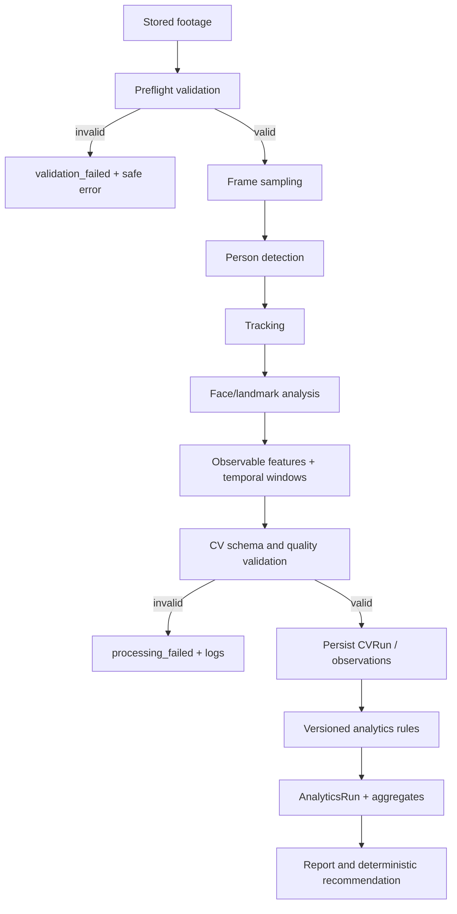

# Processing pipeline

1. **Media preflight:** verify readable container/codec, duration, dimensions, timestamps, and policy limits. Reject corrupt/unsupported media safely.
2. **Frame extraction:** sample at a configured and versioned rate/strategy; preserve time mapping. Bound memory and decode work.
3. **Person detection:** detect visible people per sampled frame; retain confidence and quality flags.
4. **Tracking:** associate detections across frames with run-scoped pseudonymous `track_ref`; do not link identities across videos.
5. **Face/landmark analysis:** estimate face visibility, head orientation, and eye state when quality permits. Store confidence and missingness; absence/occlusion is not negative evidence.
6. **Observable feature extraction:** encode explicit frame/window observations, not emotional labels.
7. **Temporal analysis:** summarize durations/patterns over defined windows with sampling and coverage metadata.
8. **Contract validation:** validate schema, ranges, timestamps, model versions, and coverage before persisting a `CVRun`.
9. **Business analytics:** separate service applies versioned, documented aggregation rules to CVRun; emits indicator codes, confidence/coverage and caveats.
10. **Reports/recommendations:** report snapshots and deterministic recommendation rules reference exact analytics run and evidence.

Use bounded concurrency, chunked frame iteration, configurable sampling, timeouts, worker memory limits, and cancellation checkpoints. Avoid persisting raw frames unless a separately approved debugging/retention use case requires it.
