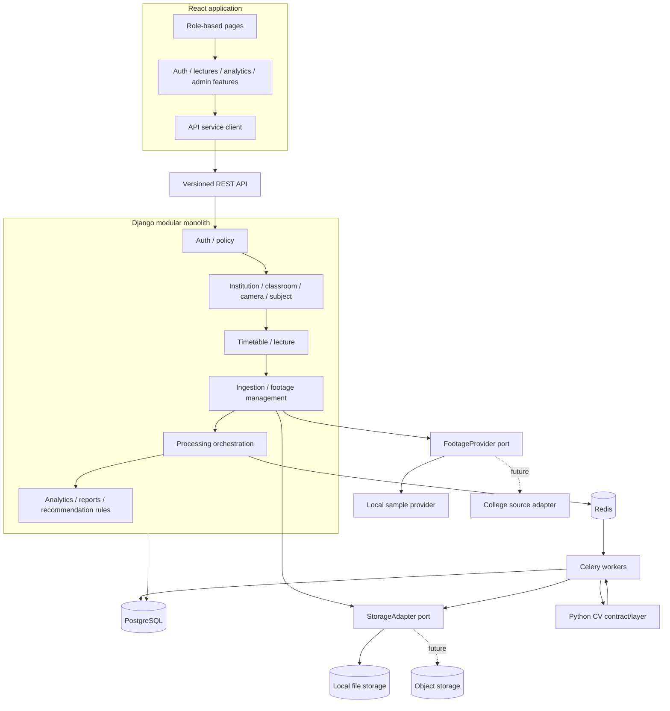

# Component architecture



Backend modules are logical Django apps/services within a modular monolith. The CV layer is separated by package/process contract; a separately deployed CV service is an option only if isolation or workload later warrants it.

In Phase 2 Compose, the `ai` service only exposes liveness. No Celery-to-AI network processing contract is wired; the future worker will use the versioned Python package contract unless measured isolation needs justify a separate service.

## React application structure (planned)

```text
frontend/src/
  app/             router, providers, route guards, app shell
  pages/
    auth/           Login
    teacher/        Dashboard, lecture list, lecture details, processing status,
                    analytics, reports, recommendations
    infrastructure/ Institution context, classrooms, and cameras (Phase 5)
    admin/          Future users, timetable, footage, processing jobs,
                    system monitoring
  features/         auth, lectures, footage, processing, analytics, reports,
                    recommendations, institution administration
  api/              shared HTTP client, auth/session handling, endpoint clients,
                    error mapping, request IDs
  components/       shared accessible tables, forms, status badges, alerts,
                    loading/empty/error states
  state/            server-state cache and small client-only UI state
  types/            API contract types
```

Use a server-state library/cache for fetched API data and local component state for ephemeral UI state; select a library in Phase 2. Keep feature domain logic on the server. Centralize 401 expiry/logout, preserve safe redirect-after-login, and return forbidden views without leaking data. Route guards are a UX aid; every API endpoint rechecks authorization. Each page has loading, empty, success, and recoverable error states. Processing status supports explicit refresh/polling with bounded frequency; no real-time camera stream is presented. Shared components remain presentation-only and keyboard accessible.
