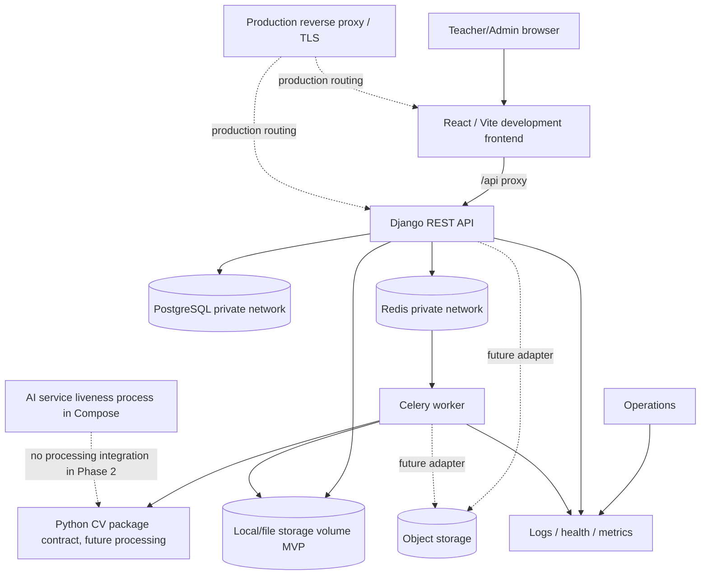

# Deployment architecture

This is a target topology; only the development services are configured in Phase 2. Compose separates the Vite frontend, Django API, PostgreSQL, Redis, Celery worker, and a liveness-only AI process. Production may serve static React assets through a reverse proxy and may separate hosts based on capacity/security review.

Keep DB/broker/storage private; serve media only through authorized application pathways. Credentials come from environment/secret management. Define backups, restore, retention, TLS, firewall, monitoring, and data-residency before production. College network/VMS connectivity is a future deployment-specific boundary and is not depicted as established connectivity.

The `ai` Compose service currently provides liveness only. The Celery worker consumes the independent Python CV package boundary only in a later processing phase; it is not a network processing service today.
