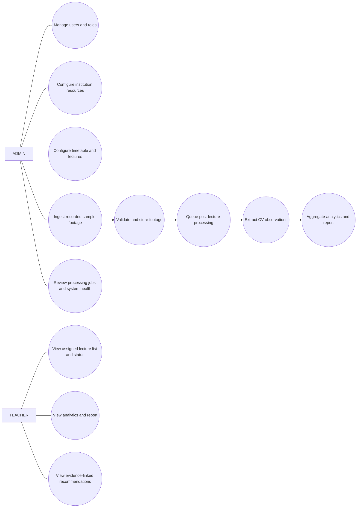

# Module architecture

The original candidates are retained with clearer ownership. Institution & Classroom Management also owns institution-scoped academic references (subjects); Administration & System Monitoring is split conceptually between access/resource administration and operational monitoring. Footage ingestion is separate from persistent asset lifecycle/storage. Analytics is separate from reports and recommendations. The dashboard is a client presentation feature, not a backend domain owner.

| Module | Purpose and responsibilities | MVP features; inputs → outputs | Dependencies, APIs, entities, events/jobs | Permissions, validation and error cases | Future scope |
|---|---|---|---|---|---|
| 1. User & Access Management | Central identity, authentication, coarse roles, reusable access policy | College-provisioned user + credentials → authenticated principal; refresh rotation and logout revocation | `/api/v1/auth/{login,refresh,logout,me}`; User, AuditEvent; JWT lifecycle | ADMIN and TEACHER can authenticate; reusable role permissions; hash and validate passwords; generic invalid-credential response; deny inactive account; object/assignment policy is enforced by each later resource API | User administration APIs, SSO/identity-provider integration, and auditable auth outcomes after policy decision |
| 2. Institution & Classroom Management | Institution tenant boundary and persistent physical classroom master data | Read own institution context; manage classrooms; no institution provisioning endpoint for institution admins | Institution/classroom APIs; Institution, Classroom; resource change audit | ADMIN scoped to own institution; TEACHER read-only; case-insensitive room code unique per institution; child lifecycle guard | Subject/teacher association and institution provisioning remain future scope |
| 3. Camera Management | Store classroom camera metadata, not live control | Register and update `LOCAL_FILE` camera metadata; metadata only | Camera API; Camera; configuration audit | ADMIN scoped through classroom; TEACHER read-only; global case-insensitive camera code; no connection or credentials | Approved CCTV/VMS/NVR provider integration in future ingestion phase |
| 4. Timetable & Lecture Management | Academic schedule and actual lecture record | Timetable entries, teacher assignment, lecture occurrence/times; schedule → lecture context | Timetable/lecture APIs; TimetableEntry, Lecture; lecture-created event | ADMIN configures; authorized teacher reads own assigned lectures; validate interval, collisions policy, timezone; reject invalid references | Import/sync timetable after source decision |
| 5. Footage Ingestion | Discover/submit and validate recorded assets through source abstraction | MVP manual sample-file intake; source reference → validated footage record and stored asset | Footage API; Footage; ingestion job/event | ADMIN ingest; validate content signature, size/duration, checksum, lecture/camera scope; unsupported/corrupt/oversize/unauthorized source fails safely | CollegeCCTVProvider for approved VMS/NVR/export/share source |
| 6. Footage Storage & Management | Abstract media bytes, metadata, integrity and retention | Local/file adapter, metadata lookup, controlled read/delete; stream/file input → opaque storage reference | StorageAdapter; Footage; storage operations in ingestion/processing | Service permissions; safe path resolution, checksum, quota; missing/corrupt/unreadable file reported | S3/MinIO/Azure adapter and migration tooling |
| 7. Processing & AI/CV Pipeline | Orchestrate jobs and isolate media/CV execution | Queue, status, retry, logs; footage ref/config → job and CV observation artifact | Processing API; ProcessingJob, ProcessingLog, CVRun/Observation; Celery task | ADMIN operations; only eligible footage; idempotency; validation failure, timeout, worker/model failure | Scale workers; model versions/accelerators after measurement |
| 8. Engagement Analytics | Apply transparent rules to CV output | Aggregate per time window/lecture with coverage; observations → versioned attention-related head-orientation proxy, drowsiness-related prolonged-eye-closure proxy where reliable, and distraction-related orientation/time-pattern proxy | Analytics API; AnalyticsRun, IndicatorAggregate; analytics task | Read gated by lecture access; deterministic validated inputs; reject schema/version/coverage-invalid output; every value carries coverage/confidence and wording as an observable proxy | Additional validated indicators after evaluation/approval; an engagement-related composite score only after a documented definition and stakeholder/evaluation approval |
| 9. Reports & Insights | Present traceable reports over analytics | Persist a lecture summary projection and report snapshot; analytics version → lecture-level summary/report view | Reports API; LectureSummary, LectureReport; report task if costly | Teacher assigned/admin; each summary/report points to its source analytics version; unavailable/stale analytics returns conflict/not-ready | Exports and comparisons after requirements |
| 10. Recommendation Engine | Generate deterministic reflection prompts from approved rules | Rule evaluation; indicators → Recommendation with evidence/rule provenance | Recommendations API; Recommendation; rules evaluation task/event | Teacher read, ADMIN manage rules only if later authorized; validate evidence; no unsupported metric or diagnosis | Optional constrained language phrasing, never metric invention |
| 11. Teacher Dashboard | React presentation for teachers/admin workflows | Login, lecture/status/results and admin pages; APIs → accessible UI states | Frontend routes/features; no owned domain entities/jobs | Route guards aid UX only; backend remains authority; handle empty/loading/denied/failed states | UX expansion from feedback |
| 12. Administration & System Monitoring | Operational health, job review, configuration and admin views | Job queue/status, worker/storage health; service telemetry → admin visibility | Admin APIs/health endpoints; ProcessingJob, ProcessingLog, AuditEvent; monitoring events | ADMIN/ops; no raw media exposure; redact sensitive diagnostics; unavailable dependency marked degraded | Alerting, retention operations, deployment metrics |

## Use case diagram

