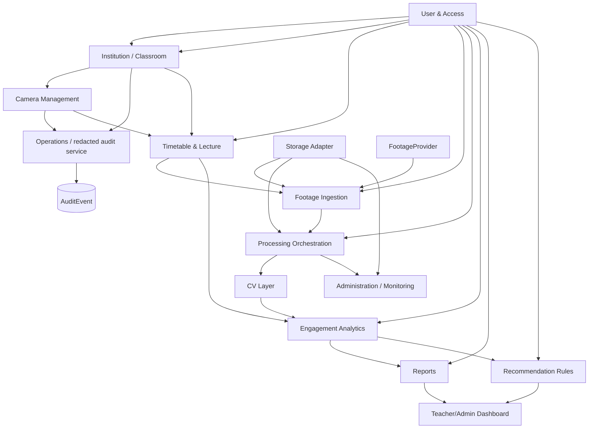

# Module dependencies

Arrows mean “depends on / consumes interface of.” Domain ownership remains with the source module; clients must not write another module's tables directly.

Phase 5 implements institution-context, classroom, and camera APIs/services plus transactional audit writes. The remaining module boundaries shown here are planned; the operations dependency is limited to safe mutation audit metadata.

Cross-module communication uses application services, REST contracts, and domain events/tasks. No module imports another module's private persistence internals. CV has no dependency on Django models, user roles, or recommendation rules. React depends on public API contracts only.
