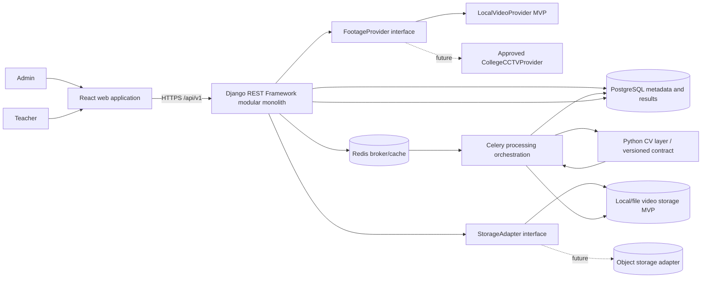

# System architecture

## System context

React clients call a versioned Django REST API. The Django modular monolith owns authorization, metadata, lifecycle orchestration, and analytics/report business rules. PostgreSQL stores records, not video bytes. A storage adapter writes and reads local files in MVP. Redis/Celery handles asynchronous processing. A Python CV layer consumes a media reference and configuration and emits structured observations; analytics consumes those observations separately. The initial footage provider is a local sample-file provider. A future approved college source adapter enters through the same ingestion boundary.

## System quality boundaries

- Requests authorize access and create/query resources; media processing is asynchronous.
- CV emits observable evidence only. Analytics owns indicator definitions and aggregation. Reports/recommendations consume versioned analytics.
- Storage keys are opaque to business logic. The adapter enforces local allowed roots, access checks, and integrity metadata.
- The footage source adapter obtains or stages recorded files; it does not define CV behavior.
- Production network, proxy, object storage, backup, retention, and CCTV details remain deployment decisions.
