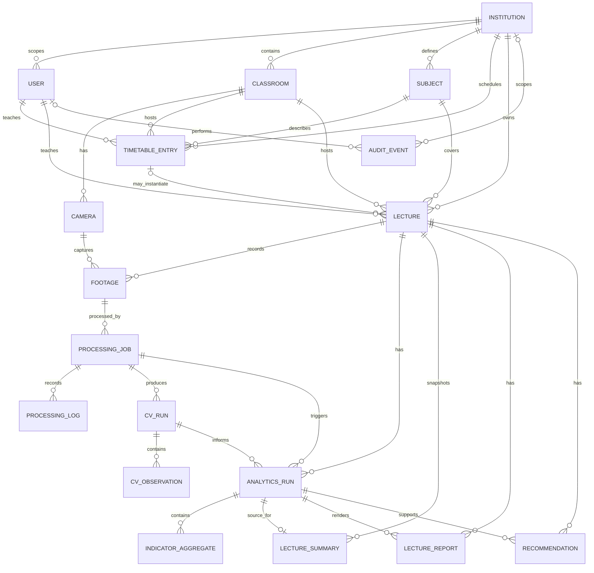
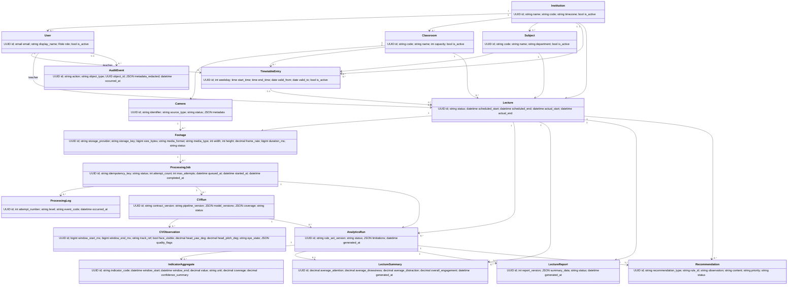

# Entity relationships and domain class diagram

This diagram reflects the Django domain models after Phase 5. Timetable entries are recurring plans; lectures are actual occurrences. Footage rows hold external storage references and metadata only. Processing jobs have many attempts/logs and may produce versioned CV runs. CV observations are observables; analytics aggregates are separate business-layer output. Track references are scoped to a CV run and do not identify a student. Camera identifiers are globally case-insensitively unique; classroom codes are unique within institution.

## ERD

## Class diagram

`LectureSummary` is a versioned persisted projection for a specific analytics run, added in Phase 3 per the implementation requirement. Its metrics are copied from that run for efficient lecture-level reads; they do not replace `IndicatorAggregate` as the source of truth. Reports and recommendations retain a foreign key to the precise analytics run.
