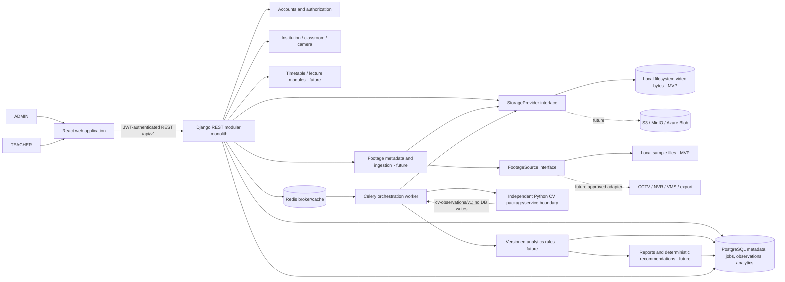
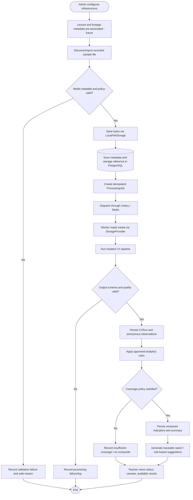
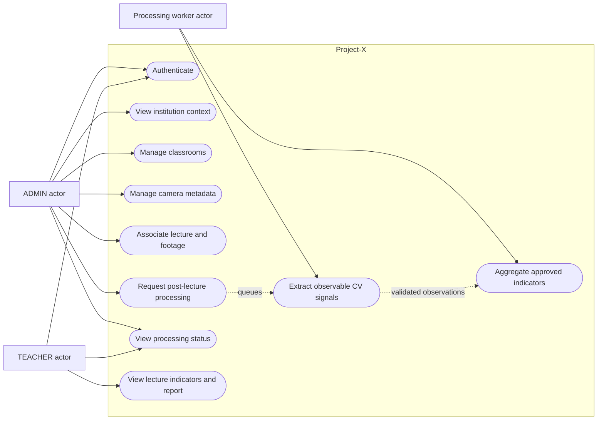
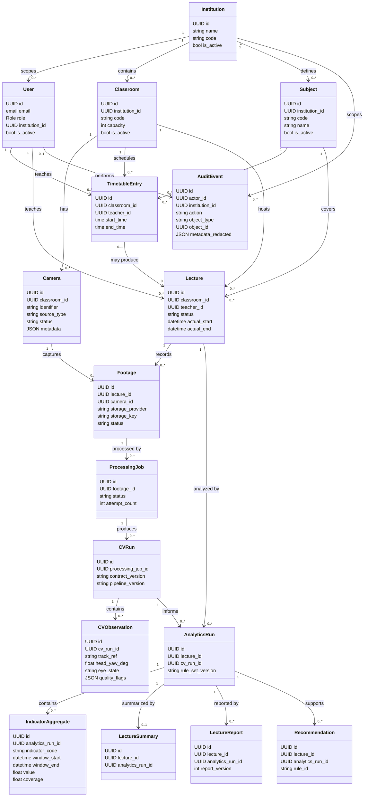
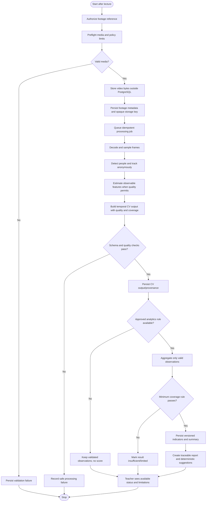
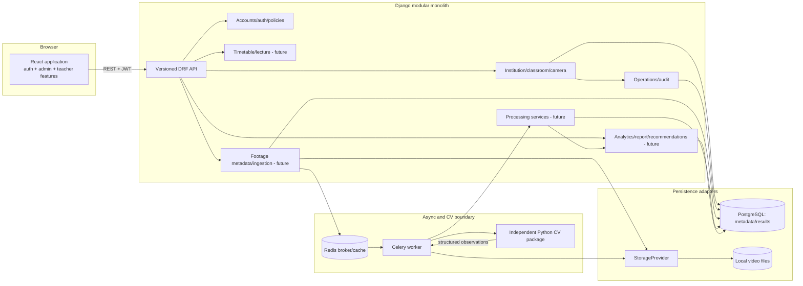
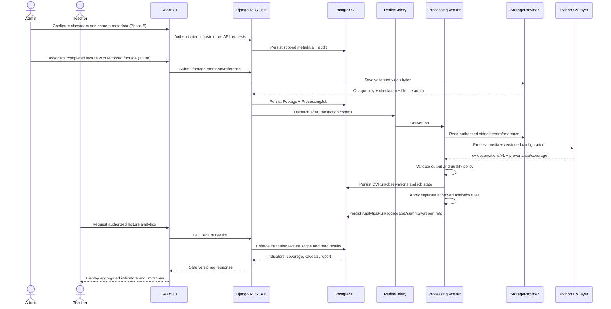

# Project-X proposed system and diagrams

> **Working name:** Project-X / Classroom Engagement Analytics. The final product name is undecided.
>
> **Status:** This is a proposed target system description aligned with the approved blueprint. Institution context, classroom, and camera management are implemented (Phase 5). Footage ingestion and downstream AI/CV, analytics, reporting, and recommendation workflows are future phases. The mathematical model below is a candidate specification for evaluation, not an implemented or approved scoring policy.

## 1. Proposed system

Project-X is a post-lecture system for processing recorded video from physical college classrooms. Administrators configure the institution, classrooms, and camera metadata. A lecture's recorded sample footage (MVP) is validated and saved through a storage adapter. Asynchronous processing extracts structured, anonymous observable signals from video. A separate analytics layer may aggregate validated signals into explainable lecture-level indicators. Teachers review reports and evidence limitations through the React application.

The system does not perform live classroom monitoring, identify students, recognize faces, or claim to measure emotions, interest, boredom, motivation, intelligence, or psychological state. Camera status is configuration metadata; it is not a connectivity health check. College CCTV/NVR/VMS integration is a future provider adapter and no vendor or protocol is assumed.

### Goals

- Help teachers review patterns from recorded lectures after class.
- Keep visual observations distinct from analytics and from any interpretation presented to users.
- Preserve evidence coverage, confidence, time windows, processing versions, and limitations with reported indicators.
- Keep video bytes outside PostgreSQL and keep source/storage providers replaceable.
- Enforce authentication and institution/lecture authorization at the backend.

### Out of scope for the current implementation

Phase 5 has implemented institution context and classroom/camera metadata management. Phase 6 and later will introduce footage lifecycle, asynchronous processing, CV, analytics, and reporting. This document does not claim those features already run. Real college CCTV connectivity, student identity, face recognition, live streaming, and model training are not part of the MVP.

## 2. Proposed methodology

1. **Configure the physical context:** provision the institution at deployment time; administrators register classrooms and `LOCAL_FILE` camera metadata. The system does not connect to the configured camera.
2. **Associate a recorded lecture:** when lecture/timetable modules are implemented, associate each recording with a lecture, classroom, camera, source timestamps, and metadata.
3. **Validate and store footage:** inspect media readability and policy constraints; calculate checksum and metadata; store video through `StorageProvider` (local filesystem for MVP); persist only reference and metadata in PostgreSQL.
4. **Queue work asynchronously:** create an idempotent `ProcessingJob`; Redis/Celery transports work and PostgreSQL remains the authoritative lifecycle record.
5. **Extract observations:** the isolated Python CV layer decodes and samples frames, detects people, assigns run-scoped anonymous track references, estimates face visibility/head orientation/eye state when quality permits, and emits the versioned CV contract.
6. **Validate output:** validate schema, times, ranges, model/pipeline versions, quality flags, and coverage. Invalid input or output fails with a safe code; uncertain or missing observations are not treated as negative evidence.
7. **Aggregate separately:** a versioned analytics service applies reviewed rules to CV observations. Indicators retain a time window, aggregation level, denominator/coverage, confidence summary, provenance, and limitations.
8. **Present traceable results:** lecture summaries/reports reference their analytics run. Recommendations, when implemented, are deterministic rules over approved indicators and link to evidence.

## 3. Proposed algorithm

The candidate processing algorithm is a staged, deterministic pipeline. Model implementations are not selected by this document; detector, tracker, landmark model, sampling policy, thresholds, and hardware profile require evaluation against representative authorized footage.

```text
INPUT: authorized footage reference, checksum, time range, pipeline configuration
OUTPUT: versioned structured CV observations or a typed safe failure

1. Resolve media via StorageProvider; verify reference, checksum, and allowed-root access.
2. Inspect container, duration, frame size/rate, and configured resource limits.
   If unreadable or outside policy: stop with a typed failure; do not create analytics.
3. Decode frames incrementally using the versioned sampling policy.
4. For each sampled frame:
   a. Detect visible people and retain detection confidence/quality flags.
   b. Associate detections only within this processing run; create anonymous track_ref values.
   c. If face/landmark quality permits, estimate face visibility, head orientation,
      and eye state (open/closed/unknown), with confidence and quality flags.
   d. Record timestamped observables; do not emit identity or mental-state labels.
5. Group observations into versioned temporal windows and calculate coverage/missingness.
6. Validate CV output against cv-observations/v1 and persist provenance.
7. In the separate analytics layer, aggregate only valid observations using approved rules.
8. Persist analytics run/indicators and lecture summary with exact source-run references.
9. Generate reports/recommendations only from completed, validated analytics.
```

### Failure handling

Media unreadable/unsupported, resource limits, model unavailable, timeout, invalid output schema, and insufficient coverage produce typed, sanitized outcomes and processing logs. Retry only transient failures according to the bounded retry policy. Do not publish a completed score for invalid or insufficient evidence. Persist neither raw frames nor face images under the MVP contract.

## 4. Candidate mathematical model

This section gives a transparent mathematical shape for indicators. It deliberately does **not** set production thresholds, window length, minimum coverage, weights, or a deployed engagement-related score. Those remain subject to representative-data evaluation and teacher/privacy review (see the AI architecture and ADRs).

### Notation and quality mask

For anonymous track $p$, sampled time $t$, and analysis window $w$:

- $\theta_{p,t}=(yaw_{p,t}, pitch_{p,t})$: estimated head orientation, if observable.
- $e_{p,t}\in\{open,closed,unknown\}$: eye state, if observable.
- $c^{head}_{p,t},c^{eye}_{p,t}\in[0,1]$: model confidence for the respective observation.
- $q^{head}_{p,t},q^{eye}_{p,t}\in\{0,1\}$: validity masks, zero when occluded, low-quality, unknown, or otherwise invalid under a versioned quality policy.
- \(\Delta t\): represented duration of a sample/window segment.
- \(\Omega_{forward}\): a camera/classroom-calibrated forward-orientation region. Calibration and angular boundaries are not selected yet.

Confidence is model confidence, not the probability that a person is attentive or interested. A track reference is temporary and scoped to one processing run, not a student identity.

### Observable ratios

**Forward-orientation ratio (attention-related proxy):**

\[
A_{p,w}=\frac{\sum_{t\in w}\Delta t\,q^{head}_{p,t}c^{head}_{p,t}\,\mathbf{1}[\theta_{p,t}\in\Omega_{forward}]}
{\sum_{t\in w}\Delta t\,q^{head}_{p,t}c^{head}_{p,t}}
\]

**Away-orientation ratio (distraction-related proxy):**

\[
X_{p,w}=\frac{\sum_{t\in w}\Delta t\,q^{head}_{p,t}c^{head}_{p,t}\,\mathbf{1}[\theta_{p,t}\notin\Omega_{forward}]}
{\sum_{t\in w}\Delta t\,q^{head}_{p,t}c^{head}_{p,t}}
\]

When both use the same valid observations and forward/away regions partition the calibrated space, these ratios are complements. They should not be presented as independent evidence.

**Observed eye-closure ratio (observable; a drowsiness-related proxy only after validation):**

\[
E_{p,w}=\frac{\sum_{t\in w}\Delta t\,q^{eye}_{p,t}c^{eye}_{p,t}\,\mathbf{1}[e_{p,t}=closed]}
{\sum_{t\in w}\Delta t\,q^{eye}_{p,t}c^{eye}_{p,t}\,\mathbf{1}[e_{p,t}\in\{open,closed\}]}
\]

This is a closure proportion, not a psychological diagnosis. A prolonged-closure rule would require an approved contiguous-duration threshold and validation; neither is defined here. Unknown/occluded eye state is excluded from the denominator and reported as reduced coverage.

### Coverage and classroom aggregation

For indicator (k), a simple observation coverage statistic is:

\[
C_{k,w}=\frac{\text{valid confidence-weighted observed duration for }k}
{\text{eligible sampled/track duration for }k}
\]

The exact eligible denominator must be specified by the selected sampling and tracking policy. If a denominator is zero, the indicator is unavailable (null/not estimable), not zero. Never treat missing/occluded observations as zero attention, open eyes, or distraction.

For valid track-window values $z_{p,k,w}$, aggregate with evidence-duration weights $r_{p,k,w}$ (valid observed duration, optionally confidence-weighted):

\[
\bar z_{k,w}=\frac{\sum_{p\in P_w}r_{p,k,w}z_{p,k,w}}
{\sum_{p\in P_w}r_{p,k,w}}
\quad\text{only when the approved coverage rule is met.}
\]

The result is a classroom-level summary for a time window; it does not represent a named student's state. Persist the indicator code, units, window bounds, sample/coverage information, confidence summary, rule-set version, processing provenance, and limitations.

### Optional composite (not approved or implemented)

If stakeholders later approve an engagement-related index after validation, a candidate form could be:

\[
G_w = g(\bar A_w,\bar E_w,\bar X_w;\,\phi)
\]

where $g$ and parameters $\phi$ (including any weights, thresholds, missing-data policy, and minimum coverage) must be explicitly versioned and approved. Do not calculate or expose $G_w$ merely from this illustrative equation. It must be described as an evidence-limited indicator from observable visual patterns, never as a direct measurement of interest, emotion, motivation, or mental engagement.

## 5. Proposed architecture and system design

### Logical architecture



The current backend is a modular monolith. The AI/CV boundary is a separate package/process boundary, not a requirement for a fleet of microservices. PostgreSQL stores metadata and structured results, never video bytes. Redis carries async messages/cache; PostgreSQL remains authoritative for job status. The worker resolves authorized media through the storage adapter, invokes CV, validates its output, and persists results through application-owned services. CV itself does not write application tables or produce business recommendations.

### Responsibility boundaries

| Component | Owns | Does not own |
|---|---|---|
| React | Forms, routes, role-aware presentation, loading/error states | Authorization decisions, scoring rules, CV |
| Django API/apps | Identity, tenant policy, domain validation, metadata, orchestration, APIs | Frame processing or model inference in views |
| PostgreSQL | User/configuration/footage references/job state/CV output/analytics/report metadata | Video binary files |
| Local storage adapter | MVP file bytes, safe references, checksum/metadata operations | Domain scoring or tenant authorization by itself |
| Redis + Celery | Async delivery and worker execution | Durable source of truth for lifecycle state |
| Python CV layer | Media decode, frame sampling, detection/tracking/landmark observations, versioned output | App DB writes, identity resolution, engagement scores, recommendations |
| Analytics | Versioned aggregation of validated observations with coverage/limits | CV model execution or unsupported psychological claims |

## 6. System flow chart



The first node (infrastructure configuration) exists in Phase 5. The remaining media and analytics processing nodes are the target flow for later phases.

## 7. Basic UML diagrams

### 7.1 Use case diagram



Use cases 1–4 reflect the completed authentication and Phase 5 infrastructure scope. Lecture/footage processing and teacher analytics are future scope.

### 7.2 Class diagram



`track_ref` is anonymous and processing-run-scoped. The entities shown are the approved domain model; future-phase rows are not claims that those workflows are implemented.

### 7.3 Activity diagram



### 7.4 Component diagram



The `- future` labels are deliberate: those application workflows are not yet implemented. CV does not connect directly to PostgreSQL. The worker/application boundary validates and persists the CV contract.

### 7.5 Sequence diagram



The infrastructure configuration portion is implemented. The footage, worker, CV, analytics, and teacher-results portions describe the target sequence for later phases.

## 8. System design summary

| Concern | Proposed design |
|---|---|
| Frontend | React SPA; typed API client; centralized auth; route guards; feature-level loading/empty/error/success states |
| Application backend | Django + DRF modular monolith; serializers validate transport data; focused services enforce business rules and transaction boundaries |
| Authentication/authorization | Existing JWT access token and HttpOnly refresh-cookie design; roles ADMIN/TEACHER; every API enforces institution/lecture scope server-side |
| Metadata database | PostgreSQL for domain records, status, file references, CV observations, analytics provenance/results, audit |
| Video storage | Local filesystem through `StorageProvider` for MVP; object storage can implement the same port later |
| Source integration | `FootageSource`; local sample footage first; college source adapter future-only, protocol not assumed |
| Async processing | Redis/Celery for dispatch; PostgreSQL status is authoritative; idempotent jobs, bounded retry, safe logs |
| AI/CV | Independent Python package/process boundary; versioned structured request/result; no database writes, identity resolution, or business metric generation |
| Analytics | Separate deterministic, versioned rules over validated CV output; report coverage, confidence, provenance, and limitations |
| Security/privacy | Institution/object authorization, opaque storage keys, no video blobs in DB, no face identity mapping, secrets excluded from API/audit/logs |

## 9. Evaluation and acceptance methodology

Before using any candidate indicator, evaluate on an approved, representative, de-identified dataset covering camera angles, seating layouts, lighting, occlusion, head pose, and video quality. Define annotation protocol and inter-rater agreement; split evaluation by lecture/classroom rather than random adjacent frames to reduce leakage. Measure detector/tracker performance, landmark/head-pose error where labels support it, eye-state precision/recall, observation coverage, calibration, failure rates, runtime, memory, and subgroup variation relevant to the deployment. Evaluate the complete end-to-end evidence pipeline, not only model accuracy.

For each proposed indicator, document its observable basis, formula, denominator, time-window policy, missingness handling, minimum coverage, uncertainty, version, and limitations. Have teachers/privacy stakeholders review wording and usefulness. Reject or withhold indicators that are unreliable or misinterpreted. Do not train models or claim psychological measurement based solely on visual proxies.

## 10. Architecture status

Phase 5 institution context, classroom/camera APIs, authorization, audit, and admin UI are implemented and reported validated. Footage ingestion/storage, processing workflow, CV inference, analytics formulas, reports, recommendations, and teacher analytics UI remain future phases. Exact production thresholds, window sizes, calibration process, composite weights, model selection, and deployment hardware remain unresolved and must be approved before implementation.
