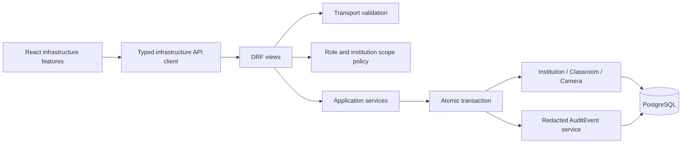
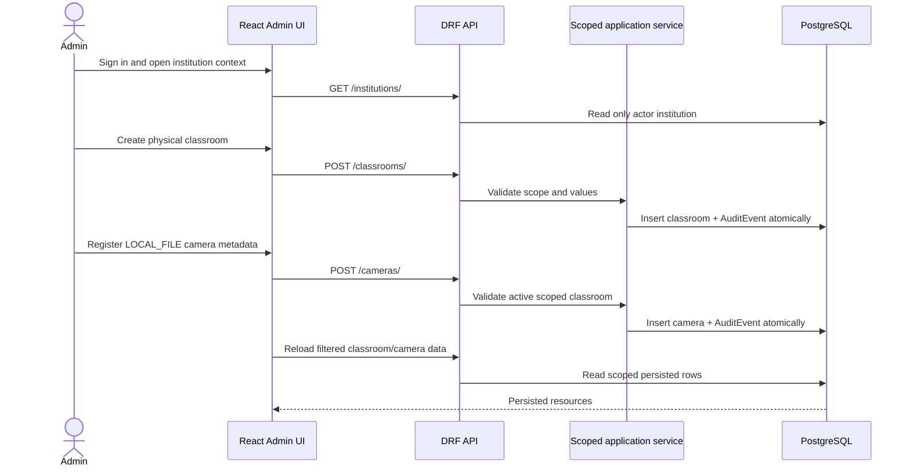

# Phase 5: institution context, classroom, and camera management

**Status:** COMPLETE. Windows Docker, PostgreSQL/Redis, migration, and browser validation were reported successful by the developer.
**Working name:** Project-X / Classroom Engagement Analytics (temporary; final name undecided)

This vertical slice covers institution context, physical classrooms, and camera metadata only. It does not implement subjects, timetable, lectures, footage, CCTV connectivity, or analytics.

## Approved decisions

- Institutions are provisioned at deployment/bootstrap time. An institution-scoped `ADMIN` cannot create one; `POST /api/v1/institutions/` is intentionally denied. No `SUPER_ADMIN` role exists.
- `ADMIN` can read and update their own institution metadata; `TEACHER` can read their own institution context.
- Room codes remain case-insensitively unique inside an institution. Internal camera codes/identifiers are case-insensitively unique globally.
- Institution scope comes from the authenticated user's institution. Client-supplied institution IDs cannot widen scope or reassign resources.
- Active classrooms block institution deactivation; active cameras block classroom deactivation. Administrators deactivate children first. No cascade deactivation or hard-delete routes exist.
- Camera writes accept metadata only and only `LOCAL_FILE`. The API excludes `source_reference`; no credentials, upload, connectivity checks, CCTV/NVR/VMS integration, or ingestion are implemented.
- Mutations write transactional `AuditEvent` records with actor, action, resource identity, request ID, and changed field names. Values and request bodies are not copied into audit metadata.

## Boundaries and request flow

Institution → Classroom → Camera is the persistent ownership chain. Camera access always resolves through its classroom and institution. Read querysets are scoped before filters, detail lookup, and serialization; inaccessible detail IDs return `404`. An explicit foreign institution filter returns `403`.

## API contract

All endpoints use `/api/v1/`, authentication, the shared error envelope, and the shared page-number pagination (`page`, `page_size`, default 25, maximum 100). Collections return `{count,next,previous,results}`. Errors use `{error:{code,message,details,request_id}}`.

| Method and endpoint | Access and purpose | Request / response notes |
|---|---|---|
| `GET /institutions/` | ADMIN/TEACHER; only caller's institution | Optional `search`; paginated institution resource |
| `POST /institutions/` | Always forbidden for institution-scoped users | Bootstrap provisioning is outside this API; `403` |
| `GET /institutions/{id}/` | ADMIN/TEACHER; own institution only | Cross-institution/missing ID returns `404` |
| `PATCH /institutions/{id}/` | ADMIN; own institution only | `name`, `code`, `timezone`, `is_active`; active classrooms block deactivation (`409`) |
| `GET /classrooms/` | ADMIN/TEACHER; own institution | Filters `institution_id` (must match), `is_active`, `search`; paginated |
| `POST /classrooms/` | ADMIN; institution derived from user | `code`, optional `name`, `capacity`, `is_active`; `201`; no institution reassignment field |
| `GET /classrooms/{id}/` | ADMIN/TEACHER; own institution | Institution context included; hidden cross-scope ID returns `404` |
| `PATCH /classrooms/{id}/` | ADMIN; own institution | Partial `code`, `name`, `capacity`, `is_active`; active cameras block deactivation (`409`) |
| `GET /cameras/` | ADMIN/TEACHER; scoped through classroom | Filters `classroom_id`, `institution_id` (must match), `status`, `source_type`, `search`; paginated |
| `POST /cameras/` | ADMIN; classroom must be active and in scope | `classroom_id`, `code`, `display_name`, optional `source_type`, `status`, `resolution`, `frame_rate`, `description`; `201` |
| `GET /cameras/{id}/` | ADMIN/TEACHER; scoped through classroom | Safe metadata only; `source_reference` is never serialized |
| `PATCH /cameras/{id}/` | ADMIN; own institution | Metadata and status; camera cannot be reassigned; inactive parent blocks activation (`409`) |

There are no `DELETE` endpoints. Standard responses include UUIDs, lifecycle status, safe labels, timestamps, and pagination. Field-detected duplicate codes return `400`; database uniqueness races and lifecycle conflicts return `409`; malformed input returns `400`; unauthenticated is `401`; a forbidden role is `403`.

## Authorization and validation

| Capability | ADMIN | TEACHER |
|---|---|---|
| Read own institution/classrooms/cameras | Yes | Yes |
| Update own institution metadata | Yes | No |
| Provision institution | No | No |
| Create/update/deactivate classroom or camera | Yes | No |
| Read or mutate another institution's objects | No | No |

Reusable institution query policies scope list and detail reads. Application services repeat scope checks while locking relevant rows inside atomic transactions. Classroom creation derives the institution from the actor; camera creation verifies the classroom is active and belongs to that institution. Serializers validate positive capacity, code uniqueness, allowed fields/source type, and metadata formats. PostgreSQL constraints remain the race-safe authority.

## Application services and audit

The layer order is HTTP view → serializer → role/scope policy → focused application service → transaction/model → audit service. Institution/classroom/camera services call `full_clean()`, map uniqueness races to a stable conflict, and commit audit with each successful mutation. Audit metadata contains only allow-listed identifiers and changed field names, never submitted values, tokens, passwords, paths, or secrets.

## React feature structure

`frontend/src/features/infrastructure/` contains shared types, typed API functions, and infrastructure pages. The authenticated shell provides role-aware navigation; routes cover `/admin`, `/admin/institution`, `/admin/classrooms`, `/admin/classrooms/:id`, `/admin/cameras`, and `/admin/cameras/:id`. The pages use actual API responses for institution context, counts, lists, create/edit/deactivate actions, and classroom-camera relations. Forms expose loading, empty, validation, API error, success, and lifecycle-conflict states. Camera status is metadata status, not connection health; the UI explicitly says connectivity is not configured.

## Workflow

Failure paths include `401` for missing authentication, `403` for teacher mutation or foreign institution filters, `404` for hidden/missing IDs, `400` for malformed/invalid fields and serializer-detected duplicate codes, `409` for database uniqueness races or active-child deactivation conflicts, and recoverable frontend network errors. Failed mutations do not emit success audit entries.

## Validation record

Developer-reported Windows Docker validation:

- `docker compose ps` showed PostgreSQL, Redis, Celery, AI, backend, and frontend healthy.
- `showmigrations` showed all application/framework migrations applied, including the camera-code uniqueness migration `cameras.0003_remove_camera_camera_classroom_identifier_ci_uniq_and_more`.
- The test command explicitly selected `project_x_backend.config.settings.test_postgres`, created the PostgreSQL test database, applied migrations, and passed Django system checks.
- PostgreSQL/Redis backend suite: **55 tests, 55 passed, 0 failed, 0 skipped**.
- Browser Admin workflow: **PASS**; persistence after reload: **PASS**; classroom lifecycle: **PASS**; camera lifecycle: **PASS**.
- Local quality checks recorded by Codex: frontend tests (10 passed), ESLint, TypeScript, Prettier, production build, Django checks, Ruff lint/format, migration-state check, and OpenAPI schema validation. OpenAPI produced zero errors and one non-blocking ambiguous `status` enum naming warning.

Codex did not independently operate the developer's Windows Docker/browser environment. This validation does not claim production deployment readiness or security certification. Phase 6 has not started.

## Explicit non-goals

No institution creation for normal admins, super-admin, teacher assignment, students, timetable, lectures, footage upload/ingestion, CCTV connectivity, AI/CV inference, analytics, reports, recommendations, or business dashboard metrics beyond counts derived from the infrastructure API.
