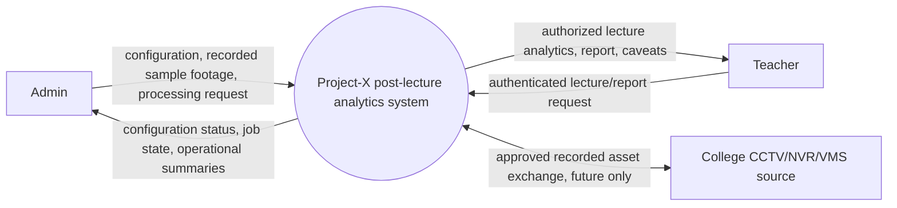
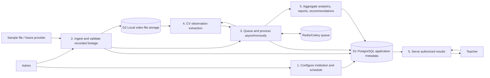

# Data-flow diagrams

## DFD Level 0: context

## DFD Level 1

PostgreSQL is D1 (metadata/results), not the video store. D2 contains video bytes. The college source is future-only; no real-time stream path exists.
