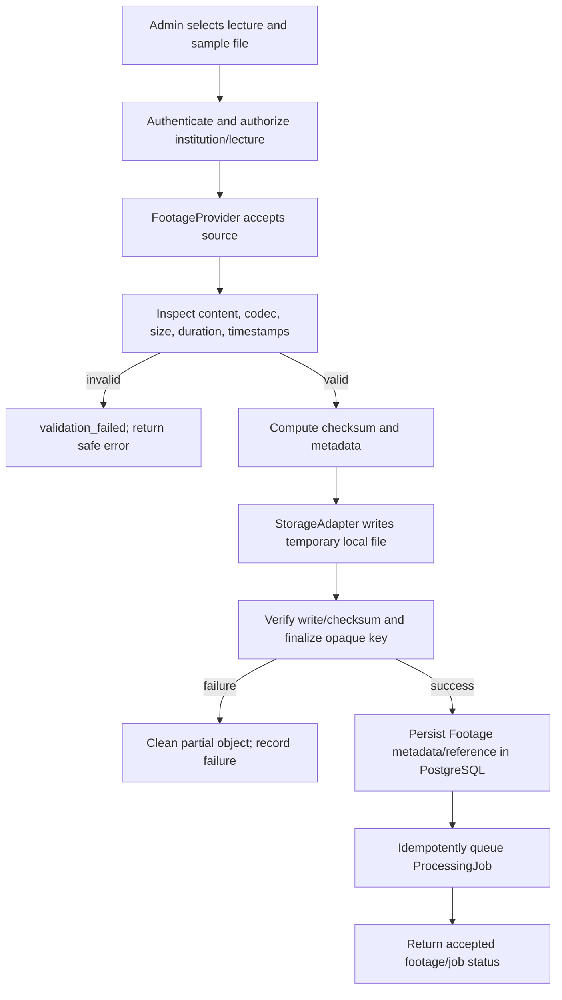
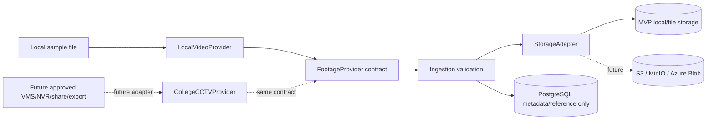

# Footage ingestion workflow

MVP source is an uploaded/provided sample recording. The future college source is an adapter boundary only.

At no point does an adapter assume which CCTV/NVR/VMS product or protocol the institution uses. The provider must return a normalized recorded asset; downstream processing sees the same storage reference contract.
