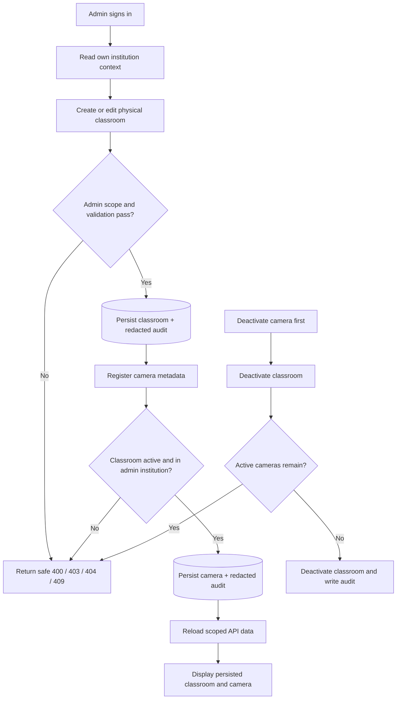

# Institution, classroom, and camera workflow

Phase 5 configures physical infrastructure metadata. The college institution is provisioned outside the API; institution admins manage resources inside their own institution. No camera connectivity is attempted.

| Actor/action | API and persisted effect |
|---|---|
| ADMIN views institution | `GET /api/v1/institutions/` returns only the actor's own institution |
| ADMIN creates classroom | `POST /api/v1/classrooms/` derives institution from authenticated user; writes classroom and redacted `AuditEvent` atomically |
| ADMIN registers camera | `POST /api/v1/cameras/` validates active in-scope classroom and `LOCAL_FILE`; writes metadata and audit atomically |
| TEACHER reads resources | GET endpoints expose read-only infrastructure within the user's institution |
| ADMIN deactivates parent | Institution/classroom transition rejects with `409` while active children remain; no child is silently changed |

Audit metadata contains actor/action/resource ID/request ID and changed field names only. It does not copy submitted values, camera source references, passwords, tokens, or secrets. Camera `ACTIVE`/`INACTIVE` describes configured metadata lifecycle, not online connectivity.
