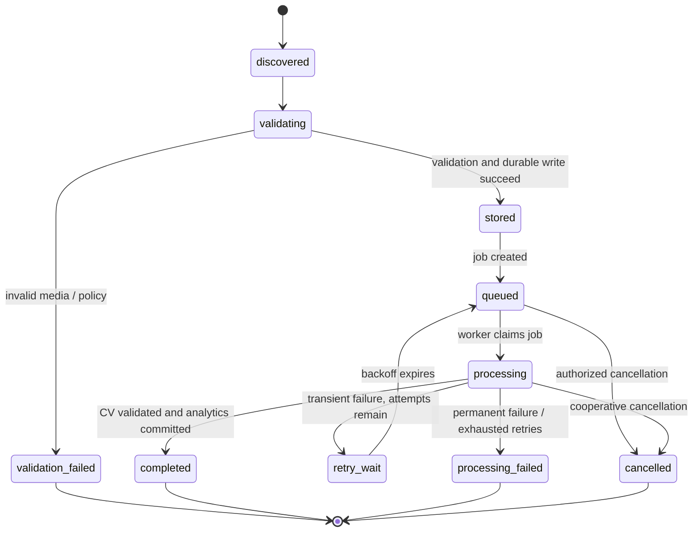

# Processing workflow and lifecycle

## Lifecycle

Footage intake states: `discovered → validating → stored → queued → processing → completed`. Terminal alternatives: `validation_failed`, `processing_failed`, and policy-driven `cancelled`; retryable worker failure transitions through `retry_wait → queued`. ProcessingJob is authoritative for attempt status; Footage may reflect summarized latest processing status. Redis messages are triggers, not status source of truth.

## Job creation and reliability

- Create a job transactionally with an outbox or `transaction.on_commit` dispatch so queue failure can be recovered; persisted DB state is authoritative.
- Idempotency key identifies the requested operation and is unique per footage + request key. Repeated same request returns existing job; key reuse with different immutable config returns `409`.
- Worker claims with atomic status transition/lease; each attempt records start/end, worker correlation, stage, and safe error code. A duplicate Celery delivery must not duplicate CVRun/AnalyticsRun side effects.
- Retry only transient infrastructure/model-timeout failures, exponential backoff with jitter and bounded attempts; validation/schema/permanent failures do not retry automatically. Manual retry creates/reopens a controlled attempt per policy and records actor/reason.
- On success persist CV result validation, analytics version, and terminal job state atomically where feasible. Cross-system storage changes use reconciliation, not false transaction assumptions.
- Admin can inspect safe logs and retry eligible failures. Teachers see status and sanitized error category only. Logs exclude tokens, paths, raw frames, and unnecessary personal data.
